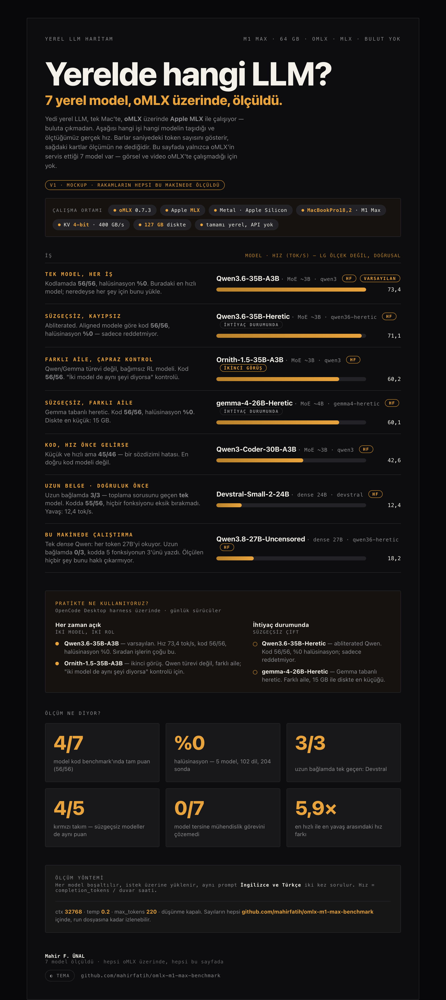
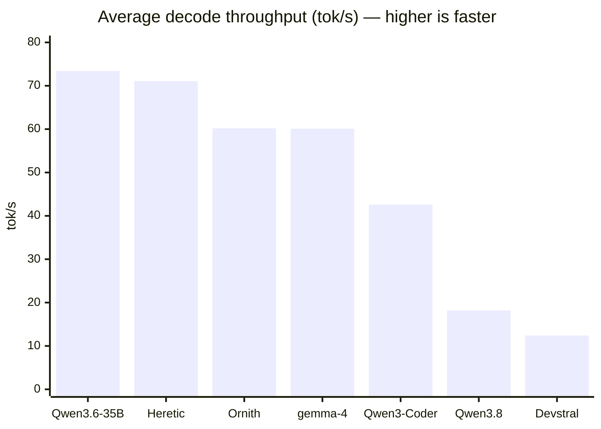
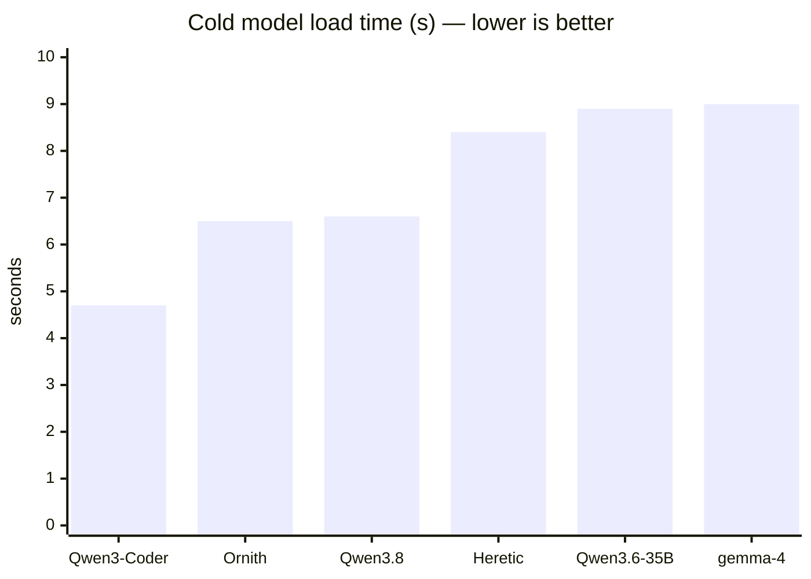
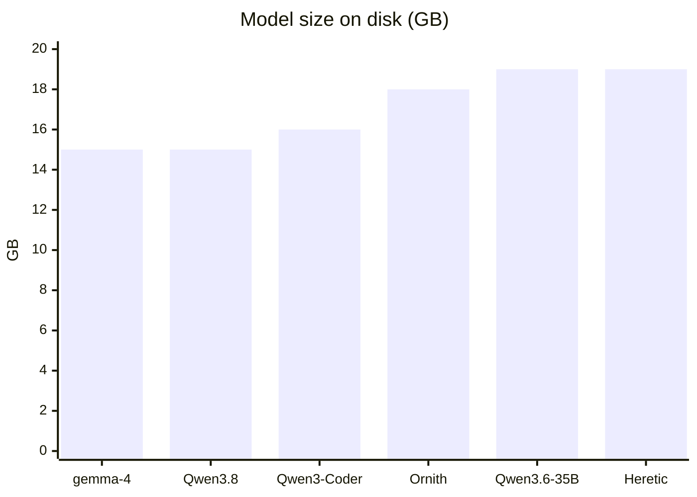

# oMLX · M1 Max · Local LLM Benchmark

> Token throughput, model sizes, profile tuning and an **uncensored / heretic** classification of 7 local LLMs served by [oMLX](https://omlx.ai) on an Apple **M1 Max (64 GB)**.

[-000?logo=apple&logoColor=white)](#hardware--software)
[](#hardware--software)
[](#hardware--software)
[](#models)
[](LICENSE)

---

## Overview

This repository documents a reproducible benchmark of **7 local LLMs** running entirely on-device with **oMLX** (an MLX-based OpenAI-compatible server) on an **Apple M1 Max with 64 GB unified memory**.

**Scope:** this repository is the **text** benchmark — everything oMLX serves. Image
and video generation are different tools (mflux, VideoX-Fun-mlx) that oMLX cannot
run, so they live in their own repository:
[mahirfatih/local-generation-benchmark-m1-max](https://github.com/mahirfatih/local-generation-benchmark-m1-max).

It covers:

- **Decode throughput** (tok/s) for English and Turkish, measured twice per language.
- **Model sizes** on disk and parameter counts.
- **Uncensored / heretic / abliterated** classification with source evidence.
- **Tuned oMLX profiles** that keep RAM usage stable (no OOM, no GPU stalls).
- **Reproduction scripts** (benchmark + multi-language code validation + repository analysis).
- **Coding correctness**: models solve algorithmic problems whose code is *executed* against hidden cases, not just parsed.
- **Repository analysis**: the models analyse a real project — [`mahirfatih/net-traffic-control-catalog`](https://github.com/mahirfatih/net-traffic-control-catalog) — and are scored on the facts they recover.

The repository layout mirrors that reference project, and one benchmark asks the
models to analyse it directly (see [Repository analysis](#repository-analysis)).
A second capability benchmark *runs* the models' code (see
[Coding benchmark](#coding-benchmark)); the problem catalogue it uses was
inspired by [`liohunter1/llm-coding-benchmark`](https://github.com/liohunter1/llm-coding-benchmark),
though the problems and cases here are original.

> All numbers below were measured on the machine described in [Hardware & Software](#hardware--software). Results vary with prompt length, quantization and background load.

## Table of Contents

- [Hardware & Software](#hardware--software)
- [Models](#models)
- [**Model comparison — which one for what**](docs/reference/COMPARISON.md)
- [**Choosing a model — which model, for what job, and why**](docs/guides/CHOOSING-A-MODEL.md)
- [Benchmark results](#benchmark-results)
- [Uncensored / Heretic classification](#uncensored--heretic-classification)
- [Profiles](#profiles)
- [Repository analysis](#repository-analysis)
- [Coding benchmark](#coding-benchmark)
- [Hallucination & error risk](#hallucination--error-risk)
- [Image and video generation — a separate repository](#image-and-video-generation--a-separate-repository)
- [Reproducing](#reproducing)
- [Repository structure](#repository-structure)
- [Notes & disclaimer](#notes--disclaimer)
- [License](#license)

---

## Hardware & Software

| Item | Value |
|---|---|
| Machine | **Apple MacBook Pro (16-inch, 2021)**, model `MacBookPro18,2` |
| Chip | **Apple M1 Max** (10-core CPU: 8P + 2E, 32-core GPU, 16-core Neural Engine) |
| Memory | **64 GB** unified |
| OS | **macOS 26.7.2** (build 25G332), arm64 |
| Server | **oMLX 0.7.3** — OpenAI-compatible at `http://127.0.0.1:8000/v1` |
| Inference | MLX, **4-bit** weights, **4-bit KV cache** (turboquant) |
| Loading | Lazy, one model at a time, auto-unload after **180 s** idle |
| Memory guard | tier `aggressive`, soft `0.85`, hard `0.95` |

The exact model matters, so it is named rather than described — the 32-core GPU
and 400 GB/s of memory bandwidth are what the throughput below is against:

- Apple's own specification: [support.apple.com/en-us/111901](https://support.apple.com/en-us/111901)
- EveryMac's breakdown of this exact configuration:
  [MacBook Pro M1 Max 10-core CPU, 32-core GPU (16-inch, 2021)](https://everymac.com/systems/apple/macbook_pro/specs/macbook-pro-m1-max-10-core-cpu-32-core-gpu-16-2021-specs.html)

The server is **oMLX**, a separate project this repository only measures:

- Source: [github.com/jundot/omlx](https://github.com/jundot/omlx)
- Project site: [omlx.ai](https://omlx.ai/)

## Models

| Model | Parameters | Disk | Quant | Source |
|---|---|---:|---|---|
| `Qwen3-Coder-30B-A3B-Instruct-4bit` | 30B MoE (~3B active) | 16 GB | 4-bit | [HF](https://huggingface.co/mlx-community/Qwen3-Coder-30B-A3B-Instruct-4bit) |
| `Qwen3.6-35B-A3B-4bit` | 35B MoE (~3B active) | 19 GB | 4-bit | [HF](https://huggingface.co/mlx-community/Qwen3.6-35B-A3B-4bit) |
| `Qwen3.6-35B-A3B-Uncensored-Heretic-MLX-4bit` | 35B MoE (~3B active) | 19 GB | 4-bit | [HF](https://huggingface.co/froggeric/Qwen3.6-35B-A3B-Uncensored-Heretic-MLX-4bit) |
| `Ornith-1.5-35B-A3B-MLX-4bit` | 35B MoE (~3B active) | 18 GB | 4-bit | [HF](https://huggingface.co/ornith-ai/Ornith-1.5-35B-A3B-MLX-4bit) |
| `gemma-4-26B-A4B-it-heretic-4bit` | 26B MoE (~4B active) | 15 GB | 4-bit | [HF](https://huggingface.co/mlx-community/gemma-4-26B-A4B-it-heretic-4bit) |
| `Qwen3.8-27B-Uncensored-MLX` | 27B dense | 15 GB | 4-bit | [HF](https://huggingface.co/orcarouter/Qwen3.8-27B-Uncensored-MLX) |
| `Devstral-Small-2-24B-Instruct-2512-8bit` | 24B dense (mistral3) | 25 GB | 8-bit | [HF](https://huggingface.co/mlx-community/Devstral-Small-2-24B-Instruct-2512-8bit) |

**Total on disk:** ~127 GB · **Runtime memory:** ~17–25 GB per loaded model.

**Pick by what you are doing:** [`docs/reference/COMPARISON.md`](docs/reference/COMPARISON.md)
puts every model against every task — coding, chat, long context, uncensored
work, images, video — on one page, with each number traced to the run file it
came from.

## Model map



[`docs/diagrams/model-map/model-map.html`](docs/diagrams/model-map/model-map.html) — the interactive version (theme toggle). [`model-map-light.png`](docs/diagrams/model-map/model-map-light.png) for the light theme.

Which model for which job, at the speed it actually ran, in one picture.

## Benchmark results

**Method:** each model is unloaded, then loaded on demand (warm-up), then asked the same English and Turkish prompts twice. Speed = `completion_tokens / wall_time`. Settings: `ctx 32768`, `temp 0.2`, `max_tokens 220`, thinking off.

| # | Model | Profile | EN tok/s | TR tok/s | **Average** | Load (s) |
|---|---|---|---:|---:|---:|---:|
| 🥇 | `Qwen3.6-35B-A3B-4bit` | `qwen3` | 72.2 | 74.7 | **73.4** | 8.9 |
| 🥈 | `Qwen3.6-35B-A3B-Uncensored-Heretic` | `qwen36-heretic` | 69.2 | 73.0 | **71.1** | 8.4 |
| 🥉 | `Ornith-1.5-35B-A3B` | `qwen3` | 60.0 | 60.4 | **60.2** | 6.5 |
| 4 | `gemma-4-26B-A4B-it-heretic` | `gemma4-heretic` | 59.5 | 60.7 | **60.1** | 9.0 |
| 5 | `Qwen3-Coder-30B-A3B-Instruct` | `qwen3` | 43.4 | 41.8 | **42.6** | 4.7 |
| 6 | `Qwen3.8-27B-Uncensored` | `qwen36-heretic` | 18.3 | 18.1 | **18.2** | 6.6 |
| 7 | `Devstral-Small-2-24B-Instruct` | `devstral` | 12.3 | 12.6 | **12.4** | 9.1 |

Rows 1–6 come from the same throughput sweep in
[`reference/results.json`](reference/results.json); Devstral was measured on its
own pass, on the same machine and prompts, after the coding run — three direct
requests (12.3, 12.6, 12.3 tok/s), because the sweep script re-runs every model
and would have overwritten the earlier results.

### Average throughput (tok/s)



### English vs Turkish (tok/s)

```mermaid
xychart-beta
    title "EN vs TR throughput (tok/s)"
    x-axis ["Qwen3.6-35B", "Heretic", "Ornith", "gemma-4", "Qwen3-Coder", "Qwen3.8", "Devstral"]
    y-axis "tok/s" 0 --> 80
    bar [72.2, 69.2, 60.0, 59.5, 43.4, 18.3, 12.3]
    bar [74.7, 73.0, 60.4, 60.7, 41.8, 18.1, 12.6]
```



*Series order: 1st bar = EN, 2nd bar = TR.*

### Cold load time (s)



### Disk size (GB)



## Uncensored / Heretic classification

> **Terminology.** **Heretic** (`p-e-w/heretic`) is a *tool/method* that performs **abliteration** — removing the refusal direction from the weights. **Uncensored** is the *result*. Every Heretic model is abliterated; not every abliterated model was made with Heretic.

| Model | Type | Uncensored | Heretic | Evidence |
|---|---|:---:|:---:|---|
| `Qwen3-Coder-30B-A3B-Instruct-4bit` | Standard instruct | ❌ | ❌ | No uncensored/heretic tags; official Qwen coder. |
| `Qwen3.6-35B-A3B-4bit` | Standard instruct | ❌ | ❌ | Official Qwen3.6 base; standard alignment. |
| `Ornith-1.5-35B-A3B-MLX-4bit` | Standard (RL post-train) | ❌ | ❌ | Ornith-1.5 on Qwen3.5 + Gemma4; no uncensored/heretic tags. |
| `gemma-4-26B-A4B-it-heretic-4bit` | **Heretic + Uncensored** | ✅ | ✅ | HF tags: `heretic`, `uncensored`, `decensored`, `abliterated`. |
| `Qwen3.6-35B-A3B-Uncensored-Heretic-MLX-4bit` | **Uncensored + Heretic** | ✅ | ✅ | HF tags include `heretic` + `uncensored`; ~88% fewer refusals, KL 0.0015. |
| `Qwen3.8-27B-Uncensored-MLX` | **Uncensored + Abliterated** | ✅ | ✅ (method) | HF card: *"abliterated (refusal-removed)"*; 0 refusals on 4/6/8-bit; local probe 3/3 no refusal. |

### Source quotes — Qwen3.8-27B-Uncensored

> *"An **abliterated** (refusal-removed) MLX build of Qwen's Qwen3.8-27B."*
> — [HF model card](https://huggingface.co/orcarouter/Qwen3.8-27B-Uncensored-MLX)

> *"This model has had its **safety alignment substantially removed** via **abliteration** (orthogonalizing the refusal direction out of the residual stream)."*
> — HF model card, Disclaimer

**Local behavior test** (`Qwen3.8-27B-Uncensored:qwen36-heretic`), 3 benign red-team probes (profanity / dark humor / manipulation monologue): **3/3 no refusal**.

**Summary**

- **Uncensored + Heretic/Abliterated:** Heretic, gemma-4-heretic, Qwen3.8-Uncensored
- **Standard / censored:** Qwen3-Coder, Qwen3.6-35B, Ornith-1.5
- **Fastest uncensored:** Qwen3.6-35B-Heretic (~71 tok/s)

## Profiles

Three global oMLX profiles are used. `qwen3` is tuned for coding (larger output); the heretic profiles are tuned for chat.

| Setting | `qwen3` | `qwen36-heretic` | `gemma4-heretic` |
|---|---:|---:|---:|
| Context window | 32768 | 32768 | 32768 |
| Max tokens | **4096** | 2048 | 2048 |
| Temperature | 0.2 | 0.2 | 0.2 |
| Top-p | 0.95 | 0.95 | 0.95 |
| Top-k | 20 | 20 | 20 |
| Repetition penalty | 1.1 | 1.1 | 1.1 |
| Min-p | 0.05 | 0.05 | 0.05 |
| Presence penalty | 0.3 | 0.3 | 0.3 |
| Thinking | off | off | off |
| KV cache 4-bit | ✅ | ✅ | ✅ |

**Model → profile**

| Model | Profile |
|---|---|
| Qwen3-Coder-30B | `qwen3` |
| Ornith-1.5-35B | `qwen3` |
| Qwen3.6-35B | `qwen3` |
| Qwen3.6-35B-Heretic | `qwen36-heretic` |
| Qwen3.8-27B-Uncensored | `qwen36-heretic` |
| gemma-4-26B-heretic | `gemma4-heretic` |

The full, machine-readable configuration is in [`profiles/omlx-profiles.json`](profiles/omlx-profiles.json). API keys are **not** included.

### Why these settings?

- **32K context + 4-bit KV cache** keeps the runtime footprint at ~17–20 GB per model, preventing the memory guard from rejecting loads.
- **`is_pinned = false` for all models** → no startup RAM spike; models load on demand and unload after 180 s idle.
- **temperature 0.2 + presence 0.3 + repetition 1.1** → stable code, fewer loops.

## Repository analysis

A second capability benchmark: how each model analyses a real repository. The
target is [`mahirfatih/net-traffic-control-catalog`](https://github.com/mahirfatih/net-traffic-control-catalog)
— a shipped CC0 catalog of 6,731 hosts, 27 categories and 22 services, the same
shape this repository mirrors. Every model gets the same digest (file tree,
README, data statistics) and the same task; the score is how many of the
repository's own facts the answer cites.

| Model | Answer (s) | tok/s | Facts recovered | Score |
| :--- | ---: | ---: | ---: | ---: |
| `Ornith-1.5-35B-A3B` | 6.8 | 53.5 | 10/12 | **83%** |
| `Qwen3-Coder-30B-A3B-Instruct` | 6.6 | 35.8 | 7/12 | **58%** |
| `Qwen3.6-35B-A3B` | 4.8 | 62.6 | 6/12 | **50%** |
| `Qwen3.6-35B-A3B-Uncensored-Heretic` | 4.7 | 57.8 | 5/12 | **42%** |
| `gemma-4-26B-A4B-it-heretic` | 4.3 | 38.6 | 4/12 | **33%** |
| `Qwen3.8-27B-Uncensored-MLX` | 46.1 | 15.2 | 0/12 | **0%** |

**The fastest answer was not the best.** Ornith-1.5 cited the real numbers
(host count, finance skew); Qwen3.6-35B answered 30% faster and recovered half
as many. Two models *invented* a file count ("6,863 files in `scripts/`"; the
true figure is **136**) — a fluent analysis with a fabricated structure. The
slowest model returned nothing at all.

Full reading: [`docs/analysis/net-traffic-control-catalog.md`](docs/analysis/net-traffic-control-catalog.md).

## Coding benchmark

A third capability benchmark, and the strictest: the model's code is **executed**,
not read. Each model is asked for a Python solution to five problems
([`problems/`](problems/README.md), 56 hidden cases) and the code is run against
those cases under a 20-second timeout.

| Model | p01 | p02 | p03 | p04 | p05 | Total |
| :--- | :---: | :---: | :---: | :---: | :---: | ---: |
| `Qwen3.6-35B-A3B` | 12/12 | 10/10 | 10/10 | 12/12 | 12/12 | **56/56** |
| `Qwen3.6-35B-A3B-Uncensored-Heretic` | 12/12 | 10/10 | 10/10 | 12/12 | 12/12 | **56/56** |
| `Ornith-1.5-35B-A3B` | 12/12 | 10/10 | 10/10 | 12/12 | 12/12 | **56/56** |
| `gemma-4-26B-A4B-it-heretic` | 12/12 | 10/10 | 10/10 | 12/12 | 12/12 | **56/56** |
| `Qwen3-Coder-30B-A3B-Instruct` | 12/12 | 10/10 | ❌ syntax | 12/12 | 11/12 | **45/46** |
| `Qwen3.8-27B-Uncensored-MLX` | 12/12 | 10/10 | ❌ not defined | 12/12 | ❌ not defined | **34/34** |

**Four models solved everything.** The failures are concrete, not stylistic:
Qwen3-Coder emitted invalid indentation after an `else` (the module import fails);
Qwen3.8 did not define the requested function name at all on two problems. The
cases with a total below 56 are problems the model's code failed to *load*, so no
case could run — a hard zero, reported as ❌.

Full reading: [`docs/analysis/code-benchmark.md`](docs/analysis/code-benchmark.md).

## Hallucination & error risk

Does a model invent APIs that do not exist? Each of 102 languages is probed with a
**real** documented API and a **fabricated twin** (`functools.reducex`, `{#eachx}`),
and the model must judge which is which.

| Model | Hallucination (fake → "real") | False alarm (real → "fake") | Brier ↓ |
| :--- | ---: | ---: | ---: |
| `Qwen3.6-35B-A3B` | **0%** (0/102) | 0% (0/102) | 0.001 |
| `Qwen3.6-35B-A3B-Uncensored-Heretic` | **0%** (0/102) | 0% (0/102) | 0.001 |
| `Ornith-1.5-35B-A3B` | **0%** (0/102) | 2% (2/102) | 0.009 |
| `gemma-4-26B-A4B-it-heretic` | **0%** (0/102) | 0% (0/102) | 0.0 |
| `Qwen3-Coder-30B-A3B-Instruct` | **0%** (0/91) | 2% (2/91) | 0.006 |

**No model invented an API.** Where the models miss, they err toward calling a
real API fake — the safe direction. `Qwen3.8-27B-Uncensored` is absent on purpose:
across three attempts it used ~5.2 hours of GPU time and still did not finish the
corpus the others complete in 1–2 minutes each.

Full reading: [`docs/analysis/hallucination.md`](docs/analysis/hallucination.md).

## Image and video generation — a separate repository

**oMLX is a text server; it cannot generate an image or a clip.** Those two layers
run on different tools — [mflux](https://github.com/filipstrand/mflux) for images,
[VideoX-Fun-mlx](https://github.com/dgrauet/VideoX-Fun-mlx) for video — on the same
M1 Max, and they are measured, documented and shipped with their outputs in their
own repository:

### → [**mahirfatih/local-generation-benchmark-m1-max**](https://github.com/mahirfatih/local-generation-benchmark-m1-max)

| Layer | Model | Time | Output |
| :--- | :--- | ---: | :--- |
| Image | FLUX.2 klein 4B (q8) | **22.5 s** | 1024×1024 PNG |
| Image | FLUX 3 Image Klein | 180.6 s | 1024×1024 PNG |
| Video | CogVideoX-Fun V1.5 5B (int8) | **266.1 s** | 672×384, 5-frame GIF |

That repository holds the two harnesses, their prompt sets and profiles, the
machine-readable results, and **the outputs themselves** — 16 images and 4 clips,
each with the prompt that produced it. This repository stays the **text**
benchmark: throughput, coding, format, long context, hallucination and red-team.

## Reproducing

1. Install and start [oMLX](https://omlx.ai) (OpenAI-compatible server on `127.0.0.1:8000`).
2. Download the models listed in [Models](#models).
3. Apply the profiles from [`profiles/omlx-profiles.json`](profiles/omlx-profiles.json) (or edit them in the oMLX UI).
4. Run the benchmark:

```bash
python3 scripts/measure/benchmark.py
```

1. Validate multi-language code generation (Python / Node.js / Bash / Swift):

```bash
python3 scripts/measure/code-matrix-test.py
```

1. Analyse a real repository and score the models on it:

```bash
python3 scripts/measure/repo-analysis-test.py --repo ~/Sites/net-traffic-control-catalog
```

1. Score coding correctness — the model's code is *run* against hidden cases:

```bash
python3 scripts/measure/code-benchmark.py --selftest   # no model needed
python3 scripts/measure/code-benchmark.py --models Qwen3.6-35B-A3B-4bit:qwen3
```

> The scripts read the API key from `~/.omlx/settings.json` and write a Markdown report.

## Repository structure

```text
omlx-m1-max-benchmark/
├── README.md · README.tr.md
├── benchmarks/                 # the raw, dated benchmark report
├── reference/                  # machine-readable data (results, models, runs)
├── config/                     # example settings + schema + model sources
├── profiles/omlx-profiles.json # sanitized oMLX profiles
├── problems/                   # coding problems with executable hidden cases
├── data/languages.json         # the 102-language hallucination corpus
├── evidence/                   # raw output of the security/red-team/benchmark runs
├── docs/                       # overview · guides · reference · analysis ·
│                               # architecture · diagrams · security · release · testing
├── scripts/
│   ├── measure/                # benchmark, code, grammar, memory, hallucination, analysis
│   ├── security/               # server probe, red-team, lab, RE challenge
│   ├── config/                 # health check, apply-profiles
│   ├── analysis/               # results renderer
│   ├── checks/                 # naming, docs-fresh
│   └── release/                # manifest
└── test/test.sh                # offline gate
```

## Notes & disclaimer

- Throughput depends on prompt length, quantization, context size and background load; treat the numbers as a snapshot, not a ranking of model quality.
- Uncensored models have had safety alignment removed and can produce harmful content. This repository documents behavior for research and comparison only; you are responsible for how you use these models.
- Model weights remain under their own licenses (see each HuggingFace page).

## License

Released under the [MIT License](LICENSE). Model weights are **not** included and keep their original licenses.
