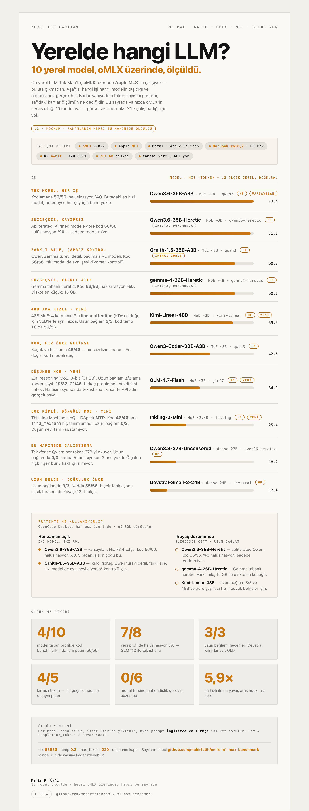

# oMLX · M1 Max · Yerel LLM Benchmark

> Apple **M1 Max (64 GB)** üzerinde [oMLX](https://omlx.ai) ile çalışan **10 yerel LLM**'in
> token hızı, model boyutları, profil ayarları ve **uncensored / heretic** sınıflandırması.

[-000?logo=apple&logoColor=white)](#donanım--yazılım)
[](https://omlx.ai)
[](#donanım--yazılım)
[](#modeller)
[](docs/security/README.md)
[](#uzun-promptlar--context-shrink)
[](#ajan-disiplini--plan-lock)
[](LICENSE)

[English](README.md) · **Türkçe**

---

<a id="genel-bakış"></a>

## 📖 Genel bakış

Bu depo, **Apple M1 Max + 64 GB** üzerinde tamamen cihaz içinde, **oMLX**
(MLX tabanlı, OpenAI uyumlu bir sunucu) ile çalışan **10 yerel LLM**'in
tekrarlanabilir bir benchmark'ını belgeler.

**Kapsam:** bu depo **metin** benchmark'ıdır — oMLX'in sunduğu her şey. Görsel ve
video üretimi oMLX'in çalıştıramadığı farklı araçlardır (mflux, mlx-gen,
VideoX-Fun-mlx), bu yüzden kendi depolarında yaşarlar:
[mahirfatih/local-generation-benchmark-m1-max](https://github.com/mahirfatih/local-generation-benchmark-m1-max).

İçerdikleri:

- İngilizce ve Türkçe için **decode hızı** (tok/s), her dil iki kez.
- **Model boyutları** ve parametre sayıları.
- Kaynak kanıtlı **uncensored / heretic / abliterated** sınıflandırması.
- RAM'i sabit tutan **ayarlı oMLX profilleri** (OOM yok, GPU takılması yok).
- **Güvenlik katmanı**: sunucu denetimi ve model red-team yetenek benchmark'ı.
- **Depo analizi**: modellerin gerçek bir projeyi ne kadar sürede ve ne kadar doğru analiz ettiği.
- **Çoğaltma script'leri** (benchmark + çok dilli kod doğrulama).

Depo yapısı, gerçek ve yayınlanmış bir referans projeyi birebir yansıtır:
[`mahirfatih/net-traffic-control-catalog`](https://github.com/mahirfatih/net-traffic-control-catalog).
Benchmark'lardan biri modellere bu projeyi doğrudan analiz ettirir
([Depo analizi](#depo-analizi)).

> Tüm sayılar [Donanım & Yazılım](#donanım--yazılım) bölümündeki makinede ölçüldü.
> Sonuçlar prompt uzunluğuna, nicelemeye ve arka plan yüküne göre değişir.

---

<a id="içindekiler"></a>

## 🗂️ İçindekiler

- [💻 Donanım & Yazılım](#donanım--yazılım)
- [🧠 Modeller](#modeller)
- [🗺️ Model haritası](#model-haritası)
- [📊 Benchmark sonuçları](#benchmark-sonuçları)
- [🚫 Uncensored / Heretic sınıflandırması](#uncensored--heretic-sınıflandırması)
- [⚙️ Profiller](#profiller)
- [🧩 Uzun prompt'lar — Context Shrink](#uzun-promptlar--context-shrink)
- [🔐 Ajan disiplini — Plan Lock](#ajan-disiplini--plan-lock)
- [🛡️ Güvenlik](#güvenlik)
- [🔍 Depo analizi](#depo-analizi)
- [🧪 Kod benchmark'ı](#kod-benchmarkı)
- [⚠️ Halüsinasyon ve hata riski](#halüsinasyon-ve-hata-riski)
- [🖼️ Görsel ve video üretimi — ayrı bir depo](#görsel-ve-video-üretimi--ayrı-bir-depo)
- [🔁 Çoğaltma](#çoğaltma)
  - [1. oMLX'i kur ve başlat](#1-omlxi-kur-ve-başlat)
  - [2. Modelleri indir](#2-modelleri-indir)
  - [3. Profilleri uygula](#3-profilleri-uygula)
  - [4. Benchmark'ı çalıştır](#4-benchmarkı-çalıştır)
- [📂 Depo yapısı](#depo-yapısı)
- [📝 Lisans](#lisans)

---

<a id="donanım--yazılım"></a>

## 💻 Donanım & Yazılım

| Öğe | Değer |
|---|---|
| Makine | **Apple M1 Max** (10 çekirdek CPU: 8P + 2E, 32 çekirdek GPU) |
| Bellek | **64 GB** birleşik |
| İşletim sistemi | **macOS 26.7.2** (25G332), arm64 |
| Sunucu | **oMLX 0.8.2** — `http://127.0.0.1:8000/v1` |
| Çıkarım | MLX, **4-bit** ağırlık, **4-bit KV cache** (turboquant) |
| Yükleme | Tembel, aynı anda tek model, 180 s boşta boşaltma |
| Bellek koruması | tier `aggressive`, soft `0.85`, hard `0.95` |

- oMLX sitesi: <https://omlx.ai>
- oMLX kaynağı: <https://github.com/jundot/omlx> (Apache 2.0)

---

<a id="modeller"></a>

## 🧠 Modeller

| Model | Parametre | Disk | Niceleme | Kaynak |
|---|---|---:|---|---|
| `Qwen3-Coder-30B-A3B-Instruct-4bit` | 30B MoE (~3B aktif) | 16 GB | 4-bit | [HF](https://huggingface.co/mlx-community/Qwen3-Coder-30B-A3B-Instruct-4bit) |
| `Qwen3.6-35B-A3B-4bit` | 35B MoE (~3B aktif) | 19 GB | 4-bit | [HF](https://huggingface.co/mlx-community/Qwen3.6-35B-A3B-4bit) |
| `Qwen3.6-35B-A3B-Uncensored-Heretic-MLX-4bit` | 35B MoE, abliterated | 19 GB | 4-bit | [HF](https://huggingface.co/froggeric/Qwen3.6-35B-A3B-Uncensored-Heretic-MLX-4bit) |
| `Ornith-1.5-35B-A3B-MLX-4bit` | 35B MoE | 18 GB | 4-bit | [HF](https://huggingface.co/ornith-ai/Ornith-1.5-35B-A3B-MLX-4bit) |
| `gemma-4-26B-A4B-it-heretic-4bit` | 26B MoE, abliterated | 15 GB | 4-bit | [HF](https://huggingface.co/mlx-community/gemma-4-26B-A4B-it-heretic-4bit) |
| `Qwen3.8-27B-Uncensored-MLX` | 27B dense, abliterated | 15 GB | 4-bit | [HF](https://huggingface.co/orcarouter/Qwen3.8-27B-Uncensored-MLX) |
| `Devstral-Small-2-24B-Instruct-2512-8bit` | 24B dense (mistral3) | 25 GB | 8-bit | [HF](https://huggingface.co/mlx-community/Devstral-Small-2-24B-Instruct-2512-8bit) |
| `GLM-4.7-Flash-8bit` | 30B MoE (~3B aktif) | 31 GB | 8-bit | [HF](https://huggingface.co/mlx-community/GLM-4.7-Flash-8bit) |
| `Kimi-Linear-48B-A3B-Instruct-4bit` | 48B MoE (~3B aktif, linear-attn) | 27 GB | 4-bit | [HF](https://huggingface.co/mlx-community/Kimi-Linear-48B-A3B-Instruct-4bit) |
| `Inkling-2-Mini-oQ4e-mtp` | 26.4B MoE (~3.4B aktif, looped, multimodal) | 16 GB | oQ4e karışık (~4.9-bit) | [HF](https://huggingface.co/mlx-community/Inkling-2-Mini-oQ4e-mtp) |

**Disk toplamı:** ~201 GB · **Çalışma zamanı:** model başına ~17–34 GB (8-bit GLM en büyük ayak izi).

---

<a id="model-haritası"></a>

## 🗺️ Model haritası



[`docs/diagrams/model-map/model-map.html`](docs/diagrams/model-map/model-map.html) — interaktif sürüm (tema değiştirilebilir). [`model-map-dark.png`](docs/diagrams/model-map/model-map-dark.png) koyu tema için.

Hangi işi hangi modelin taşıdığı ve ölçülen hız, tek sayfada.

---

<a id="benchmark-sonuçları"></a>

## 📊 Benchmark sonuçları

**Yöntem:** her model boşaltılır, istek üzerine yüklenir (ısınma), sonra aynı
İngilizce ve Türkçe prompt iki kez sorulur. Hız = `completion_tokens / geçen süre`.
Ayarlar: `ctx 65536`, `temp 0.2`, `max_tokens 220`, thinking kapalı.

| # | Model | Profil | EN tok/s | TR tok/s | **Ortalama** | Yükleme (s) |
|---|---|---|---:|---:|---:|---:|
| 🥇 | `Qwen3.6-35B-A3B-4bit` | `qwen3` | 72.2 | 74.7 | **73.4** | 8.9 |
| 🥈 | `Qwen3.6-35B-A3B-Uncensored-Heretic` | `qwen36-heretic` | 69.2 | 73.0 | **71.1** | 8.4 |
| 🥉 | `Ornith-1.5-35B-A3B` | `qwen3` | 60.0 | 60.4 | **60.2** | 6.5 |
| 4 | `gemma-4-26B-A4B-it-heretic` | `gemma4-heretic` | 59.5 | 60.7 | **60.1** | 9.0 |
| 5 | `Kimi-Linear-48B-A3B-Instruct` | `kimi-linear` | 58.5 | 59.4 | **59.0** | 7.7 |
| 6 | `Qwen3-Coder-30B-A3B-Instruct` | `qwen3` | 43.4 | 41.8 | **42.6** | 4.7 |
| 7 | `GLM-4.7-Flash-8bit` | `glm47` | 34.9 | 35.0 | **34.9** | 9.7 |
| 8 | `Inkling-2-Mini-oQ4e-mtp` | `inkling` | 25.1 | 25.7 | **25.4** | 4.9 |
| 9 | `Qwen3.8-27B-Uncensored` | `qwen36-heretic` | 18.3 | 18.1 | **18.2** | 6.6 |
| 10 | `Devstral-Small-2-24B-Instruct` | `devstral` | 12.3 | 12.6 | **12.4** | 9.1 |

Kimi-Linear, GLM ve Inkling 2026-11-22 kampanyasında (oMLX 0.8.2) hem
`temp 0.2` hem `temp 1.0` ile ölçüldü; iki ayar da gürültü sınırında aynı çıktı,
tablo `temp 0.2` değerlerini gösterir. Tam tablo, grafikler ve ham rapor:
[`docs/reference/RESULTS.md`](docs/reference/RESULTS.md) ·
[`benchmarks/2026-11-22-m1max.md`](benchmarks/2026-11-22-m1max.md).

---

<a id="uncensored--heretic-sınıflandırması"></a>

## 🚫 Uncensored / Heretic sınıflandırması

> **Heretic** (`p-e-w/heretic`) abliterasyon yapan bir *araç/yöntemdir*;
> **Uncensored** ise *sonuçtur*. Her Heretic model abliterated'dır, ama her
> abliterated model Heretic aracıyla yapılmamış olabilir.

| Model | Tür | Uncensored | Heretic / abliterated |
|---|---|:---:|:---:|
| Qwen3-Coder-30B | standart | ❌ | ❌ |
| Qwen3.6-35B | standart | ❌ | ❌ |
| Ornith-1.5-35B | standart | ❌ | ❌ |
| **gemma-4-26B-Heretic** | heretic + uncensored | ✅ | ✅ |
| **Qwen3.6-35B-Heretic** | uncensored + heretic | ✅ | ✅ |
| **Qwen3.8-27B-Uncensored** | uncensored + abliterated | ✅ | ✅ |
| Devstral-Small-2-24B | standart | ❌ | ❌ |
| GLM-4.7-Flash | standart | ❌ | ❌ |
| Kimi-Linear-48B | standart | ❌ | ❌ |
| Inkling-2-Mini | standart | ❌ | ❌ |

Kanıtlar, HF alıntıları ve yerel davranış testleri:
[`docs/reference/MODELS.md`](docs/reference/MODELS.md).

---

<a id="profiller"></a>

## ⚙️ Profiller

| Ayar | `qwen3` | `qwen36-heretic` | `gemma4-heretic` |
|---|---:|---:|---:|
| Context | 65536 | 65536 | 65536 |
| Max tokens | **4096** | 2048 | 2048 |
| Temperature | 0.2 | 0.2 | 0.2 |
| Top-p / Top-k | 0.95 / 20 | 0.95 / 20 | 0.95 / 20 |
| Repetition penalty | 1.1 | 1.1 | 1.1 |
| Min-p / Presence | 0.05 / 0.3 | 0.05 / 0.3 | 0.05 / 0.3 |
| Thinking | kapalı | kapalı | kapalı |
| KV cache 4-bit | ✅ | ✅ | ✅ |

2026-11-22 kampanyası her yeni model için bir **model-özel** profil ekledi
(`glm47`, `kimi-linear`, `inkling`); üçü de bu temeli klonlar. Her birinin yalnızca
`temperature`'ı 1.0'a çıkaran bir `*-hot` eşi vardır; Inkling ayrıca kendi
DSpark **Lightning MTP** draft'ını açan `inkling-mtp` / `inkling-mtp-hot` çiftini taşır.

Tam ayarlar: [`docs/reference/PROFILES.md`](docs/reference/PROFILES.md).

---

<a id="uzun-promptlar--context-shrink"></a>

## 🧩 Uzun prompt'lar — Context Shrink

64K bilinçli bir tercih: KV cache'i ~17–34 GB'ta ve prefill'i kısa tutuyor. Bedeli
uzun oturumlarda görünür — biriken prompt tavanı aşınca oMLX isteği reddeder:

```text
Prompt is too long: 39514 tokens > 32768 maximum context length
```

`max_context_window`'u yükseltmek duvarı ileri taşır ama kaldırmaz; fazladan her
token bellekte ve prefill süresinde ödenir. **Daha küçük prompt**
göndermek daha ucuz bir çözüm, bu yüzden bu depo
**[Context Shrink](https://github.com/mahirfatih/context-shrink-mcp)**
MCP sunucusunu öneriyor: istekten önce context'i ölçer, sunucunun isteği
reddetmesini beklemek yerine en eski mesajları düşürür ya da özete indirir.

| Araç | Ne döner |
| :--- | :--- |
| `estimate_context` | Tahmini token, kalan bütçe, `should_trim` |
| `trim_context` | En eski mesajlar düşürülmüş mesaj listesi |
| `compact_context` | En eski mesajlar özetle değiştirilmiş liste (`keep_last` korunur) |

`trim_context` eski turları atar; `compact_context` özlerini korur — yerel modelle
özetletir ya da verdiğin hazır özeti kullanır (o durumda hiç model çağrısı yapmaz).

Tek dosyalık Python; aynı Mac'te sistem `python3`'ü ile çalışır (`pip install mcp`).
Yerleşik penceresi `32768`'dir, bu yüzden bu profile `--max-context 65536` ile
sabitleyin; OpenCode tarafında da oMLX sağlayıcısı eşleşen
`"limit": { "context": 65536, "output": 4096 }` taşımalıdır. Kurulum ve OpenCode
yapılandırması [README'sinde](https://github.com/mahirfatih/context-shrink-mcp#readme);
profil düzeyindeki not [`docs/reference/PROFILES.md`](docs/reference/PROFILES.md#long-prompts--context-shrink)
içinde.

---

<a id="ajan-disiplini--plan-lock"></a>

## 🔐 Ajan disiplini — Plan Lock

Yukarıdaki benchmark'lar tek bir cevabı ölçer. Bu modelleri **kod ajanı** olarak
kullanmak farklı bir hata ortaya çıkardı: yanlış cevap değil, aynı anda fazla
cevap. Özellikle 30B sınıfı Qwen modellerinde ([Modeller](#modeller) içindeki
`Qwen3-Coder-30B-A3B` kod modeli), kodu değiştirme isteği tek turda sekiz-on tool
ve shell çağrısı olarak geri geliyor. Her çıktı aynı konuşmaya düşüyor, alakasız
komutların sonuçları iç içe geçiyor, başarısız bir adım başarılıların arasında
kayboluyor ve bir sonraki tur model "nerede kalmıştım?"ı bu gürültüden yeniden
çıkarmak zorunda kalıyor. Yerel donanımda KV cache ilerlemeyi değil defter-tutma
token'larını büyütüyor — [Context Shrink](#uzun-promptlar--context-shrink) ile
context tavanında korunan 64K bütçe, bu kez tek bir turun içinde de tüketiliyor.

Bir turda birden fazla tool çağrısı üretmenin genel adı *parallel tool calling*;
buradaki daha özel hata, aralarında **bağımlılık sırası olmayan** çağrılar —
**koordine edilmemiş fan-out**; aynı anda birkaç dosya düzenleniyorsa
*scattergun editing*. Konuşma sonra **context thrashing**'e kayıyor: durum
yerleşmeden sürekli değişiyor. Sorun paralellik değil, koordinasyonun yokluğu.

Bu depo **[Plan Lock MCP](https://github.com/mahirfatih/planlock-mcp)**'yi
öneriyor: planı modelin dışında, bir markdown dosyasında tutan ve tek seferde
yalnızca bir atomik, doğrulanabilir adım yapılmasını zorunlu kılan küçük bir
stdio MCP sunucusu.

| Araç | Ne yapar |
| :--- | :--- |
| `plan_create` | Planı yazar (önceki planı yedekler) ve mutlak yolunu bildirir. |
| `plan_next` | Sıradaki `[ ]` adımı `[~]` olarak açar; başka adım aktifken reddeder. |
| `plan_done` | Aktif adımı `[x]` işaretler ve bir not ekler. |
| `plan_fail` | Aktif adımı `[!]` işaretler ve nedenini ekler. |

Disiplin prompt'ta değil sunucuda: bir adım `[~]` iken `plan_next` ikinci bir
açılışı reddeder. Plan durumu diskte ve atomik yazımlarla tutulur; çökme veya
yeniden başlatma sonrası model tahmin etmek yerine işaretli adımdan devam eder,
plan dosyası da otomatik olarak git'ten uzak tutulur. Bu,
yukarıdaki [Kod benchmark'ını](#kod-benchmarkı) tamamlıyor: o modellerin yazdığı
kodu puanlar, Plan Lock ise kodu yazarken işin sırasını düzenler.

Kurulum, OpenCode yapılandırması ve tasarım notları
[README'sinde](https://github.com/mahirfatih/planlock-mcp#readme).

---

<a id="güvenlik"></a>

## 🛡️ Güvenlik

İki katman, ikisi de yerel ve yetkili kullanım için:

- **Sunucu denetimi** — [`scripts/security/security-probe.py`](scripts/security/security-probe.py):
  loopback bind, LAN açığı, `/v1` ve admin auth, auth'suz OpenAPI, wildcard CORS;
  `--model` ile prompt injection / jailbreak direnci.
- **Red-team yetenek benchmark'ı** — [`scripts/security/redteam-benchmark.py`](scripts/security/redteam-benchmark.py):
  yerel, kasıtlı olarak zafiyetli bir lab'a karşı exploit üretimi + tersine
  mühendislik.

Bulgular ve tehdit modeli: [`docs/security/README.md`](docs/security/README.md).
Sonuç tablosu: [`docs/security/OFFENSIVE-BENCHMARK.md`](docs/security/OFFENSIVE-BENCHMARK.md).

> Bu araçlar **yalnızca kendi makinene** karşı çalışır. Probe, loopback olmayan
> hedefi reddeder; lab sadece `127.0.0.1` dinler. Üçüncü taraf sistemlere
> yöneltmek yasadışıdır ve bu araçların amacı değildir.

---

<a id="depo-analizi"></a>

## 🔍 Depo analizi

İkinci bir yetenek benchmark'ı: her modelin gerçek bir depoyu nasıl analiz ettiği.
Hedef: [`mahirfatih/net-traffic-control-catalog`](https://github.com/mahirfatih/net-traffic-control-catalog)
— 6.731 host, 27 kategori ve 22 servis içeren, yayınlanmış CC0 bir katalog. Her
modele aynı özet (dosya ağacı, README, veri istatistikleri) ve aynı görev verilir;
puan, cevabın deponun kendi gerçeklerinden kaç tanesini andığıdır.

| Model | Cevap (s) | tok/s | Bulunan gerçek | Puan |
| :--- | ---: | ---: | ---: | ---: |
| `Ornith-1.5-35B-A3B` | 6.8 | 53.5 | 10/12 | **83%** |
| `Kimi-Linear-48B` | 5.7 | 45.9 | 8/12 | **67%** |
| `Qwen3-Coder-30B-A3B-Instruct` | 6.6 | 35.8 | 7/12 | **58%** |
| `Qwen3.6-35B-A3B` | 4.8 | 62.6 | 6/12 | **50%** |
| `GLM-4.7-Flash` | 7.4 | 25.9 | 6/12 | **50%** |
| `Qwen3.6-35B-A3B-Uncensored-Heretic` | 4.7 | 57.8 | 5/12 | **42%** |
| `gemma-4-26B-A4B-it-heretic` | 4.3 | 38.6 | 4/12 | **33%** |
| `Qwen3.8-27B-Uncensored-MLX` | 46.1 | 15.2 | 0/12 | **0%** |
| `Inkling-2-Mini` | 31.0 | 22.6 | 0/12 | **0%** |

**En hızlı cevap en iyisi değildi.** Ornith-1.5 gerçek sayıları andı; Qwen3.6-35B
%30 daha hızlı cevaplayıp yarısı kadar gerçek buldu. **Dört model olmayan bir dosya
sayısı uydurdu** (`scripts/` için "6.863–6.864 dosya"; gerçek: **136**) — uydurma
bir yapıyla akıcı bir analiz. En yavaş model hiç cevap vermedi. Devstral bu görevde
çalıştırılmadı.

Tam analiz: [`docs/analysis/net-traffic-control-catalog.md`](docs/analysis/net-traffic-control-catalog.md).

---

<a id="kod-benchmarkı"></a>

## 🧪 Kod benchmark'ı

Üçüncü yetenek benchmark'ı ve en katı olanı: modelin kodu **çalıştırılır**, sadece
okunmaz. Her modelden beş problem için Python çözümü istenir
([`problems/`](problems/README.md), 56 gizli vaka) ve kod, 20 saniyelik zaman
aşımı altında bu vakalara karşı çalıştırılır.

| Model | p01 | p02 | p03 | p04 | p05 | Toplam |
| :--- | :---: | :---: | :---: | :---: | :---: | ---: |
| `Qwen3.6-35B-A3B` | 12/12 | 10/10 | 10/10 | 12/12 | 12/12 | **56/56** |
| `Qwen3.6-35B-A3B-Uncensored-Heretic` | 12/12 | 10/10 | 10/10 | 12/12 | 12/12 | **56/56** |
| `Ornith-1.5-35B-A3B` | 12/12 | 10/10 | 10/10 | 12/12 | 12/12 | **56/56** |
| `gemma-4-26B-A4B-it-heretic` | 12/12 | 10/10 | 10/10 | 12/12 | 12/12 | **56/56** |
| `Kimi-Linear-48B` (`temp 1.0`) | 12/12 | 10/10 | 10/10 | 12/12 | 12/12 | **56/56** |
| `Devstral-Small-2-24B-Instruct` | 12/12 | 10/10 | 10/10 | 12/12 | 11/12 | **55/56** |
| `Kimi-Linear-48B` (`temp 0.2`) | 12/12 | 10/10 | 5/10 | 12/12 | 12/12 | **51/56** |
| `Inkling-2-Mini` (dört profil) | 12/12 | 10/10 | ❌ tanımsız | 12/12 | 12/12 | **46/46** |
| `Qwen3-Coder-30B-A3B-Instruct` | 12/12 | 10/10 | ❌ sözdizimi | 12/12 | 11/12 | **45/46** |
| `Qwen3.8-27B-Uncensored-MLX` | 12/12 | 10/10 | ❌ tanımsız | 12/12 | ❌ tanımsız | **34/34** |
| `GLM-4.7-Flash` (`temp 1.0`) | 12/12 | 5/10 | ❌ sözdizimi | 3/12 | 1/12 | **21/46** |
| `GLM-4.7-Flash` (`temp 0.2`) | 12/12 | 2/10 | 5/10 | ❌ sözdizimi | ❌ sözdizimi | **19/32** |

**Kimi-Linear, yeni modellerin en güçlüsü** — 56/56'ya ulaşan tek 2026-11-22
modeli ve yalnızca `temp 1.0`'da (`temp 0.2`'de 51/56, beş `p03` kenar vakasını
kaybederek). Bir kod modeli olan **Devstral** istenen tüm fonksiyonları tanımladı
ve 55/56 geçti. **GLM-4.7-Flash buradaki en zayıf kodlayıcı** (en iyi 21/46, açık
sözdizimi hatalarıyla) ve **Inkling `find_median`'ı hiç tanımlamıyor**, bu yüzden
`p03` çalışamıyor. Hatalar somut: Qwen3-Coder bir `else` sonrası geçersiz girinti
üretti; Qwen3.8 istenen fonksiyonlardan ikisini hiç tanımlamadı. Toplamı 56'nın
altındaki bir satır, kodun *yüklenemediği* bir problemdir; hiç vaka çalışmaz —
❌ olarak raporlanan kesin sıfır.

Tam analiz: [`docs/analysis/code-benchmark.md`](docs/analysis/code-benchmark.md).

---

<a id="halüsinasyon-ve-hata-riski"></a>

## ⚠️ Halüsinasyon ve hata riski

Bir model var olmayan API'leri uyduruyor mu? 102 dilin her biri, gerçek bir
dokümante API ile **uydurma bir eşi** (`functools.reducex`, `{#eachx}`) üzerinden
yoklanır ve modelin hangisinin gerçek olduğunu söylemesi istenir.

| Model | Halüsinasyon (uydurma → "gerçek") | Yanlış alarm (gerçek → "uydurma") | Brier ↓ |
| :--- | ---: | ---: | ---: |
| `Qwen3.6-35B-A3B` | **0%** (0/102) | 0% (0/102) | 0.001 |
| `Qwen3.6-35B-A3B-Uncensored-Heretic` | **0%** (0/102) | 0% (0/102) | 0.001 |
| `Ornith-1.5-35B-A3B` | **0%** (0/102) | 2% (2/102) | 0.009 |
| `gemma-4-26B-A4B-it-heretic` | **0%** (0/102) | 0% (0/102) | 0.0 |
| `Qwen3-Coder-30B-A3B-Instruct` | **0%** (0/91) | 2% (2/91) | 0.006 |
| `Kimi-Linear-48B` | **0%** (0/102) | 1% (1/102) | 0.005 |
| `GLM-4.7-Flash` | **2%** (2/85) | 2% (2/80) | 0.11 |
| `Inkling-2-Mini` | **0%** (0/102) | 0% (0/102) | 0.005 |

**Bir model API uydurdu.** `GLM-4.7-Flash`, iki uydurma eşi **gerçek** saydı —
`matlab zerosx` (1.00 güvenle) ve `NSArrayx` — hem `temp 0.2` hem `temp 1.0`
koşusunda; Brier puanı (0,11) buradaki her şeyin ~20 katı: yanıldığında emin.
Her iki koşudaki diğer tüm kaçırmalar güvenli tarafta — gerçek bir API'ye
"uydurma" denmesi (Kimi bir tane yaptı: Pascal `writeln`). `Qwen3.8-27B-Uncensored`
tabloda yok, bilerek: üç denemede **~5,2 saat** GPU zamanı harcayıp diğerlerinin
1–2 dakikada bitirdiği korpüsü yine de tamamlayamadı. Devstral yoklanmadı. GLM'in
paydaları (85/80) 102 değil, cevapladığı yoklamalardır; cevaplanmayanlar hata
sayılmaz.

Tam analiz: [`docs/analysis/hallucination.md`](docs/analysis/hallucination.md).

---

<a id="görsel-ve-video-üretimi--ayrı-bir-depo"></a>

## 🖼️ Görsel ve video üretimi — ayrı bir depo

**oMLX bir metin sunucusudur; ne bir görsel ne de bir klip üretebilir.** Bu iki
katman aynı M1 Max üzerinde farklı araçlarla çalışır — görsel için
[mflux](https://github.com/filipstrand/mflux) (ikisi
[mlx-gen](https://github.com/lpalbou/mlx-gen) ile), video için
[VideoX-Fun-mlx](https://github.com/dgrauet/VideoX-Fun-mlx) ve mlx-gen — ve
ölçümleri, dokümantasyonları ile çıktıları kendi depolarında yayımlanır:

### → [**mahirfatih/local-generation-benchmark-m1-max**](https://github.com/mahirfatih/local-generation-benchmark-m1-max)

| Katman | Araç | Model | Süre | Çıktı |
| :--- | :--- | :--- | ---: | :--- |
| **Görsel** | mflux | FLUX.2 klein 4B (q4) | **23.0 s** | 1024×1024 PNG |
| Görsel | mflux | FLUX.2 klein 4B (q8) | 24.0 s | 1024×1024 PNG |
| Görsel | mflux | Anima Turbo (q8) | 36.4 s | 1024×1024 PNG |
| Görsel | mflux | Z-Image Turbo (q4) | 95.8 s | 1024×1024 PNG |
| Görsel | mflux | FLUX.2 klein 4B Base (q8) | 97.1 s | 1024×1024 PNG |
| Görsel | mlx-gen | ERNIE Image Turbo (q8) | 123.5 s | 1024×1024 PNG |
| Görsel | mlx-gen | Qwen Image (mixed q4/q8) | 124.9 s | 1024×1024 PNG |
| Görsel | mflux | FLUX 3 Image Klein | 180.6 s | 1024×1024 PNG |
| **Video** | VideoX-Fun-mlx | CogVideoX-Fun V1.5 5B (int4) | **247.7 s** | 672×384, 5 kare GIF |
| Video | mlx-gen | Wan2.2 TI2V 5B (int8) | 255.6 s | 480×832, 25 kare MP4 |
| Video | VideoX-Fun-mlx | CogVideoX-Fun V1.5 5B (int8) | 262.1 s | 672×384, 5 kare GIF |

Her sayı, model yüklemesi dâhil duvar saati süresidir ve her çıktı yazdığı dosyaya
karşı doğrulanır (görseller için PNG başlığı, klipler için `ffprobe`). Görsel
rakamları ilk görselden *sonraki* ortalamadır — ilk görsel tek seferlik model
yüklemesini öder; her video rakamı ilgili modelin altı klip üzerindeki ortalamasıdır.
Görsellerin tümü artık 1024×1024'tür, böylece görsel sütunu elmayla elmayı
karşılaştırır. İki görsel satırı mflux'tan geçmez: `ernie-image-turbo-q8` ve
`qwen-image-4bit` mlx-gen ile çalışır. Klipler ve görseller
[`evidence/`](https://github.com/mahirfatih/local-generation-benchmark-m1-max/tree/main/evidence)
altındadır; iddia "güven" ile değil, bakarak doğrulanabilir.

Bu depo **harness'ları**, prompt setlerini, profilleri ve makine okunur sonuçları
tutar; **çıktıların kendisini de** — zamanlanan her görsel ve 18 klibin tamamı,
her biri kendisini üreten prompt ile birlikte. İlk koşunun çok ötesine geçti: **sekiz
ölçülmüş görsel modeli ve üç video modeli**. En sert lisanslı satırlar — Anima Turbo
(**Circlestone, ticari kullanıma kapalı**) ve FLUX 3 (FLUX Kommunity) — o deponun
lisans okumasında karara bağlanır. Bu depo ise **metin** benchmark'ı olarak kalır:
token hızı, kod, format, uzun bağlam, halüsinasyon ve red-team.

---

<a id="çoğaltma"></a>

## 🔁 Çoğaltma

### 1. oMLX'i kur ve başlat

[oMLX](https://omlx.ai)'i kur ve başlat (`127.0.0.1:8000`, OpenAI uyumlu).

### 2. Modelleri indir

[🧠 Modeller](#modeller) listesindeki modelleri indir.

### 3. Profilleri uygula

Profilleri uygula ([`profiles/omlx-profiles.json`](profiles/omlx-profiles.json)):

```bash
python3 scripts/config/apply-profiles.py --apply
```

### 4. Benchmark'ı çalıştır

```bash
python3 scripts/measure/benchmark.py
python3 scripts/measure/code-matrix-test.py
python3 scripts/measure/repo-analysis-test.py --repo ~/Sites/net-traffic-control-catalog
python3 scripts/measure/code-benchmark.py --selftest   # model gerekmez
python3 scripts/measure/code-benchmark.py --models Qwen3.6-35B-A3B-4bit:qwen3
```

Ayrıntılı adımlar: [`docs/guides/REPRODUCING.md`](docs/guides/REPRODUCING.md).

---

<a id="depo-yapısı"></a>

## 📂 Depo yapısı

```text
omlx-m1-max-benchmark/
├── README.md / README.tr.md
├── docs/
│   ├── overview/     ne ölçüldü
│   ├── guides/       yöntem, çoğaltma, model seçimi
│   ├── reference/    modeller, profiller, sonuçlar
│   ├── security/     tehdit modeli + red-team
│   ├── testing/      ne nasıl doğrulanır
│   └── diagrams/     etkileşimli mimari diyagramı
├── benchmarks/       ham rapor
├── profiles/         sanitize edilmiş oMLX profilleri
├── config/           örnek global ayarlar
└── scripts/          ölçüm + güvenlik araçları
```

---

<a id="lisans"></a>

## 📄 Lisans

[MIT](LICENSE). Model ağırlıkları **dahil değildir** ve kendi lisanslarını korur.
