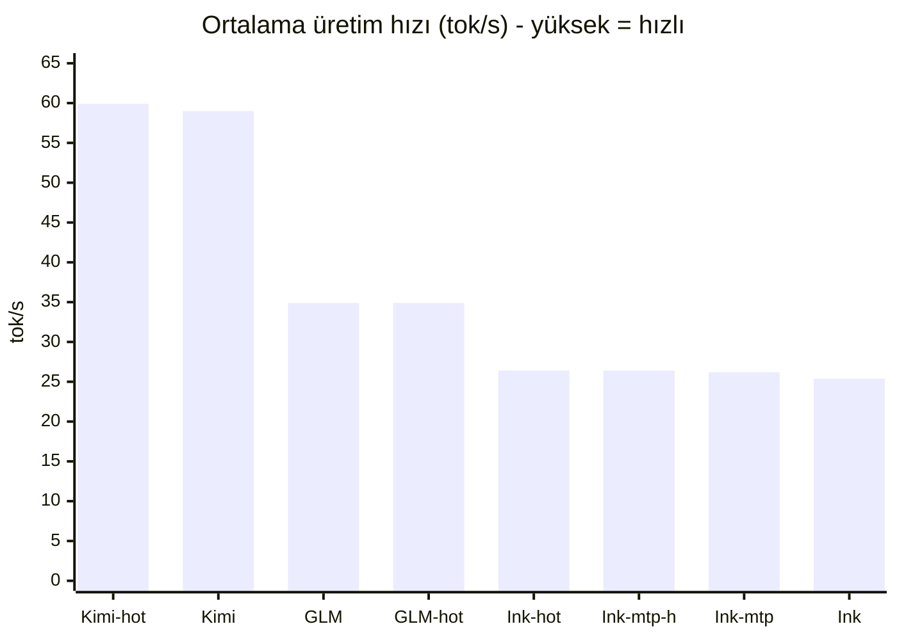
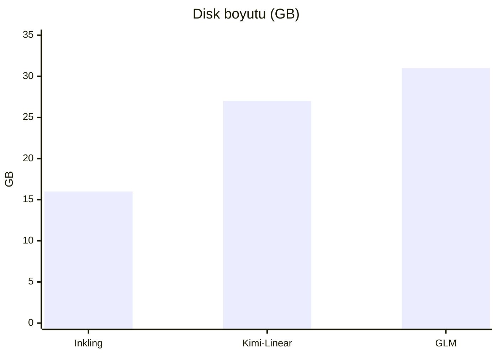

# oMLX 2026-11-22 Kampanyası — üç yeni model, iki sıcaklık, MTP

- **Tarih:** 2026-11-22
- **Donanım:** Apple M1 Max, 64 GB RAM
- **Sunucu:** oMLX **0.8.2** (`127.0.0.1:8000`)
- **Kapsam:** Yeni indirilen üç model (`Kimi-Linear-48B-A3B-Instruct-4bit`,
  `GLM-4.7-Flash-8bit`, `Inkling-2-Mini-oQ4e-mtp`), her biri **iki örnekleme
  ayarında** (`temp 0.2` ve `temp 1.0`) ve Inkling ayrıca kendi **DSpark MTP**
  taslağı **açık/kapalı** olarak. Toplam **8 profil**.
- **Ayarlar:** ctx 65536, top_p 0.95, top_k 20, min_p 0.05, rep 1.1, presence 0.3,
  thinking kapalı, KV 4-bit (turboquant).
- **Yöntem:** Throughput için her model boşaltıldı, yüklendi, ısıtıldı, ardından
  İngilizce ve Türkçe prompt ikişer kez çalıştırıldı; hız =
  `completion_tokens / geçen süre` (tok/s). Diğer setler için aynı profil
  çiftleri kullanıldı.

Bu rapor, 2026-11-11 tarihli ilk koşunun (`benchmarks/2026-11-11-m1max.md`,
oMLX 0.7.3) **üzerine** yazılmıştır; o dosya tarih olarak olduğu gibi korunur.

## Profiller

| # | Model | Profil | Sıcaklık | MTP |
|---|---|---|---|---|
| 1 | `Kimi-Linear-48B-A3B-Instruct-4bit` | `kimi-linear` | 0.2 | — |
| 2 | `Kimi-Linear-48B-A3B-Instruct-4bit` | `kimi-linear-hot` | 1.0 | — |
| 3 | `GLM-4.7-Flash-8bit` | `glm47` | 0.2 | — |
| 4 | `GLM-4.7-Flash-8bit` | `glm47-hot` | 1.0 | — |
| 5 | `Inkling-2-Mini-oQ4e-mtp` | `inkling` | 0.2 | ❌ |
| 6 | `Inkling-2-Mini-oQ4e-mtp` | `inkling-hot` | 1.0 | ❌ |
| 7 | `Inkling-2-Mini-oQ4e-mtp` | `inkling-mtp` | 0.2 | ✅ |
| 8 | `Inkling-2-Mini-oQ4e-mtp` | `inkling-mtp-hot` | 1.0 | ✅ |

## Throughput (tok/s)

| # | Model | Profil | Sıcaklık | EN tok/s | TR tok/s | Ortalama | Yükleme (s) |
|---|---|---|---|---|---|---|---|
| 1 | `Kimi-Linear-48B-A3B-Instruct-4bit` | `kimi-linear-hot` | 1.0 | 60.4 | 59.3 | **59.9** | 7.0 |
| 2 | `Kimi-Linear-48B-A3B-Instruct-4bit` | `kimi-linear` | 0.2 | 58.5 | 59.4 | **59.0** | 7.7 |
| 3 | `GLM-4.7-Flash-8bit` | `glm47` | 0.2 | 34.9 | 35.0 | **34.9** | 9.7 |
| 4 | `GLM-4.7-Flash-8bit` | `glm47-hot` | 1.0 | 35.0 | 34.7 | **34.9** | 11.4 |
| 5 | `Inkling-2-Mini-oQ4e-mtp` | `inkling-hot` | 1.0 | 26.4 | 26.4 | **26.4** | 3.4 |
| 6 | `Inkling-2-Mini-oQ4e-mtp` | `inkling-mtp-hot` | 1.0 | 26.3 | 26.5 | **26.4** | 3.4 |
| 7 | `Inkling-2-Mini-oQ4e-mtp` | `inkling-mtp` | 0.2 | 26.2 | 26.2 | **26.2** | 3.2 |
| 8 | `Inkling-2-Mini-oQ4e-mtp` | `inkling` | 0.2 | 25.1 | 25.7 | **25.4** | 4.9 |

### Okuma

- **Sıcaklık hızı değiştirmiyor.** Her üç modelde de `temp 0.2` ile `temp 1.0`
  arasındaki fark ölçüm gürültüsü seviyesinde (≤1 tok/s).
- **MTP ölçülebilir kazanç sağlamadı.** Inkling'in DSpark MTP taslağı açıkken
  (26.2–26.4) kapalıyken (25.4–26.4) ile aynı. Bu donanımda draft model kabul
  oranı, ek yükünü karşılamamış.
- **Kimi-Linear 48B olmasına rağmen 35B sınıfı hızda.** Katmanlarının 3'ü 4
  **Kimi Delta Attention** (linear attention) kullandığı için token başına okunan
  ağırlık, adının ima ettiğinden çok daha az. Bu, tablodaki en ilginç sonuç.
- **GLM-4.7-Flash 8-bit ve düşünen bir MoE**; 31 GB disk ve agresif bellek
  koruması altında yükleme 10–11 s sürüyor.
- **Inkling en hızlı yüklenen** (3–5 s) ama en yavaş üreten model.

## Yetenek setleri

### Kod (çalıştırılan)

Kod bloğu çıkarılıp gizli testlerle **çalıştırıldı**.

| Model (profil) | p01 | p02 | p03 | p04 | p05 | Toplam |
|---|:---:|:---:|:---:|:---:|:---:|---:|
| `Kimi-Linear-48B` (`kimi-linear`) | 12/12 | 10/10 | 5/10 | 12/12 | 12/12 | **51/56** |
| `Kimi-Linear-48B` (`kimi-linear-hot`) | 12/12 | 10/10 | 10/10 | 12/12 | 12/12 | **56/56** |
| `GLM-4.7-Flash` (`glm47`) | 12/12 | 2/10 | 5/10 | ❌ | ❌ | **19/32** |
| `GLM-4.7-Flash` (`glm47-hot`) | 12/12 | 5/10 | ❌ | 3/12 | 1/12 | **21/46** |
| `Inkling-2-Mini` (dört profil) | 12/12 | 10/10 | ❌ | 12/12 | 12/12 | **46/46** |

- **Kimi-Linear en güçlüsü**, ve yeni modeller içinde tek **56/56** — ama bunu
  yalnızca `temp 1.0`'da yapıyor. `temp 0.2`'da `p03`'ün beş vakasını kaybediyor.
- **GLM en zayıf kodlayıcı.** `p04` ve `p05`'i `temp 0.2`'da tümden kaybediyor
  (geçersiz sözdizimi), `temp 1.0`'da kısmen topluyor (21/46).
- **Inkling tutarlı ama eksik.** Dört profilin dördü de aynı 46/46: `find_median`
  fonksiyonunu hiç tanımlamıyor, `p03` çalışmıyor. MTP ve sıcaklık hiçbir şeyi
  değiştirmiyor.

### Format / dilbilgisi

| Model | person | verdict | matrix | Geçerli |
|---|:---:|:---:|:---:|---:|
| `GLM-4.7-Flash` (her iki profil) | ✅ | ✅ | ✅ | **3/3** |
| `Kimi-Linear-48B` (her iki profil) | ✅ | ✅ | ✅ | **3/3** |
| `Inkling-2-Mini` (dört profil) | ✅ | ✅ | ✅ | **3/3** |

Üç model de şema-geçerli JSON üretti. Fark doğrulukta değil, sürede: Kimi ~0,4 s,
GLM ~1,1 s, Inkling ~7,5 s (düşünme bloğu yüzünden).

### Uzun bağlam hafızası

6,3 k token'lık belge; iğne, çakışma ve toplama soruları.

| Model (profil) | retrieval | conflict | aggregate | Hatırlanan |
|---|:---:|:---:|:---:|---:|
| `GLM-4.7-Flash` (`glm47`) | ✅ | ✅ | ✅ | **3/3** |
| `GLM-4.7-Flash` (`glm47-hot`) | ✅ | ✅ | ✅ | **3/3** |
| `Kimi-Linear-48B` (`kimi-linear`) | ✅ | ✅ | ✅ | **3/3** |
| `Kimi-Linear-48B` (`kimi-linear-hot`) | ✅ | ✅ | ✅ | **3/3** |
| `Inkling-2-Mini` (dört profil) | ❌ | ❌ | ❌ | **0/3** |

Kimi-Linear ve GLM üç görevi de geçti; Inkling dört profilde de sıfır aldı. Bu,
mevcut modellerde yalnızca Devstral'ın başarabildiği bir sonuç ve iki yeni modelin
de metin üretmekte zorlanmadığını gösteriyor.

### Depo analizi

`net-traffic-control-catalog` üzerinde, on iki belgelenmiş olgudan kaçının
anıldığı.

| Model (profil) | Yanıt (s) | tok/s | Olgu | Skor |
|---|---:|---:|---:|---:|
| `Kimi-Linear-48B` (`kimi-linear`) | 5.7 | 45.9 | 8/12 | **67%** |
| `Kimi-Linear-48B` (`kimi-linear-hot`) | 4.4 | 60.5 | 7/12 | **58%** |
| `GLM-4.7-Flash` (`glm47`) | 7.4 | 25.9 | 6/12 | **50%** |
| `Inkling-2-Mini` (`inkling-mtp`) | 34.9 | 20.1 | 5/12 | **42%** |
| `GLM-4.7-Flash` (`glm47-hot`) | 4.9 | 29.6 | 4/12 | **33%** |
| `Inkling-2-Mini` (`inkling`, `-hot`, `-mtp-hot`) | 28–31 | 22.6–25.2 | 0/12 | **0%** |

Kimi-Linear yeni modeller içinde en iyi analist ve mevcut Qwen3.6'yı (6/12) geçiyor.
Inkling dört profilin üçünde **boş yanıt** döndürdü; 700 token'lık bütçesi düşünme
bloğunda tükendi.

## Kod sözdizimi matrisi

Her modelden dört dilde küçük birer fonksiyon istendi ve dönen kod ilgili dilin
kendi denetleyicisine verildi (`py_compile`, `node --check`, `bash -n`,
`swiftc -parse`). Kod hiç dönmeyen bir model `boş` olarak işaretlendi, sözdizimi
hatası olarak değil.

| Model (profil) | python | nodejs | bash | swift |
|---|:---:|:---:|:---:|:---:|
| `GLM-4.7-Flash` (her iki profil) | ✅ | ✅ | ✅ | ✅ |
| `Kimi-Linear-48B` (her iki profil) | ✅ | ✅ | ✅ | ✅ |
| `Inkling-2-Mini` (dört profil) | ❌ boş | ✅ | ❌ boş | ✅ |

GLM ve Kimi dört dilde de geçerli kod üretti. **Inkling dört profilde de Python ve
Bash istemlerine hiç kod döndürmedi** — bu, kodun sözdizimi hatası değil, kısa
yanıtları boşaltan düşünme bloğunun bir sonucu; Node ve Swift yanıtları geçerli.
Ham çıktı: [`../evidence/code-matrix-2026-11-22.md`](../evidence/code-matrix-2026-11-22.md).

## Inkling'in düşünme sınırı

**Inkling-2-Mini düşünmeyi kapatamıyor.** Her yanıttan önce ~140 token'lık bir
akıl yürütme bloğu üretiyor; `max_tokens` küçükse `content` boş kalıyor. Bu
kampanyada:

- 220 token'lık throughput prompt'unda içerik yine geldi (ölçüm geçerli).
- 700 token'lık depo analizinde üç profilde metin gelmedi.
- Çözüm olarak `max_tokens` yükseltildi; ama bu sefer yanıt bütçesi düşünmeye
  gidiyor.

Bu, modelin bir kusuru değil, arayüzün varsayımıyla (thinking kapatılabilir)
uyuşmaması; raporda belgeleniyor, etrafından dolanılmıyor.

## Halüsinasyon

102 dilin her biri iki kez sınandı: bir **gerçek** belgelenmiş API, bir de onun
**uydurma ikizi** (`zeros` → `zerosx`, `NSArray` → `NSArrayx`). Model her ad için
"gerçek mi, uydurma mı" kararını ve bir güven değeri verir.

| Model (profil) | Yanıtlanan | Doğruluk | Halüsinasyon | Yanlış alarm | Brier ↓ | Aşırı emin + yanlış |
|---|---:|---:|---:|---:|---:|---:|
| `Inkling-2-Mini` (`inkling-mtp`, `-mtp-hot`) | 204/204 | %100 | **%0** | %0 | 0.005–0.007 | 0 |
| `Inkling-2-Mini` (`inkling`, `-hot`) | 188/204 | %100 | **%0** | %0 | 0.004 | 0 |
| `Kimi-Linear-48B` (her iki profil) | 204/204 | %100 | **%0** | %1 | 0.005 | 1 |
| `GLM-4.7-Flash` (her iki profil) | 165/204 | %98 | **%2** | %2 | 0.11 | 3 |

- **GLM iki sahte adı "gerçek" saydı:** `matlab zeros`'un `zerosx` ve Objective-C
  `NSArray`'ın `NSArrayx` ikizini — ilkini **1.00** güvenle. İki sıcaklıkta da
  aynı iki isim, yani tekrarlanabilir bir zayıflık, gürültü değil.
- **Kimi ve Inkling hiç halüsinasyon üretmedi.** Kimi bir kez Pascal `writeln`'i
  sahte saydı; bu **yanlış alarm** — güvenli yön, çünkü kullanıcı dokümana bakar.
- **GLM'in Brier'i (0.11) diğerlerinden ~20 kat kötü.** Model yalnızca yanlış
  değil, yanlış olduğunda aşırı emin; 3 sonda "aşırı emin + yanlış".
- **Kapsam bir donanım gerçeği, model skoru değil.** GLM 204 sondan 39'una
  (bozuk JSON), Inkling'in iki profili 16'sına (düşünme bloğu) yanıt veremedi;
  bunlar yanlış sayılmadı, doğruluk paydasından çıkarıldı.
- **Yalnızca GLM'in yanıldığı diller** ortak havuzda `matlab` ve `objective-c`.

Sonda bazında tam kayıt (her dil, her isim, verilen güven):
[`../reference/hallucination-records-2026-11-22.md`](../reference/hallucination-records-2026-11-22.md).

## Grafikler

### Ortalama hız (tok/s) — sekiz profil

### Disk boyutu (GB) — üç yeni model

## Sistem ve model bilgileri

| Öğe | Değer |
|---|---|
| Sunucu | **oMLX 0.8.2** (`http://127.0.0.1:8000/v1`) |
| İşlemci | **Apple M1 Max** (10 çekirdek: 8P+2E) |
| Bellek | **64 GB** birleşik RAM |
| İşletim sistemi | **macOS 26.7.2** (25G332), arm64 |
| Çıkarım | MLX, 4/8-bit/oQ ağırlık, 4-bit KV cache (turboquant) |
| Bellek koruması | `aggressive`, soft 0.85, hard 0.95 |

| Model | Parametre | Disk | Niceleme | Dizin |
|---|---|---|---|---|
| `Kimi-Linear-48B-A3B-Instruct-4bit` | 48B (MoE, ~3B aktif) | 27 GB | 4-bit | `mlx-community/` |
| `GLM-4.7-Flash-8bit` | 30B (MoE, ~3B aktif) | 31 GB | 8-bit | `mlx-community/` |
| `Inkling-2-Mini-oQ4e-mtp` | 26.4B (MoE, ~3.4B aktif) | 16 GB | oQ4e karışık | `mlx-community/` |

## Ham veri ve kaynaklar

- Throughput: [`../reference/throughput-2026-11-22.json`](../reference/throughput-2026-11-22.json)
- Kod: [`../reference/code-benchmark-2026-11-22.json`](../reference/code-benchmark-2026-11-22.json),
  [`../evidence/code-benchmark-2026-11-22.md`](../evidence/code-benchmark-2026-11-22.md)
- Format: [`../reference/grammar-2026-11-22.json`](../reference/grammar-2026-11-22.json),
  [`../evidence/grammar-2026-11-22.md`](../evidence/grammar-2026-11-22.md)
- Uzun bağlam: [`../reference/context-memory-2026-11-22.json`](../reference/context-memory-2026-11-22.json),
  [`../evidence/context-memory-2026-11-22.md`](../evidence/context-memory-2026-11-22.md)
- Depo analizi: [`../reference/repo-analysis-2026-11-22.json`](../reference/repo-analysis-2026-11-22.json),
  [`../evidence/repo-analysis-2026-11-22.md`](../evidence/repo-analysis-2026-11-22.md)
- Halüsinasyon: [`../reference/hallucination-2026-11-22.json`](../reference/hallucination-2026-11-22.json),
  [`../evidence/hallucination-2026-11-22.md`](../evidence/hallucination-2026-11-22.md),
  [`../reference/hallucination-records-2026-11-22.md`](../reference/hallucination-records-2026-11-22.md)
- Kod sözdizimi matrisi: [`../evidence/code-matrix-2026-11-22.md`](../evidence/code-matrix-2026-11-22.md)

Tüm modeller HuggingFace API'sinden doğrulanmıştır:
[Kimi-Linear-48B-A3B-Instruct-4bit](https://huggingface.co/mlx-community/Kimi-Linear-48B-A3B-Instruct-4bit) ·
[GLM-4.7-Flash-8bit](https://huggingface.co/mlx-community/GLM-4.7-Flash-8bit) ·
[Inkling-2-Mini-oQ4e-mtp](https://huggingface.co/mlx-community/Inkling-2-Mini-oQ4e-mtp)
