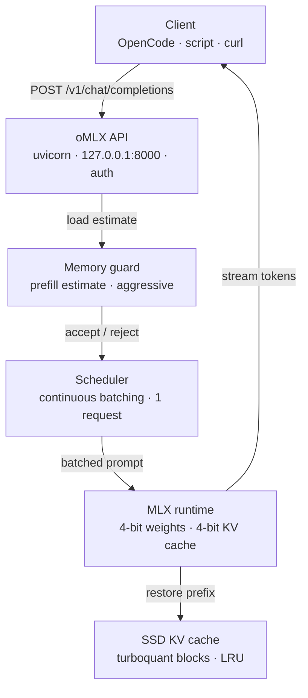
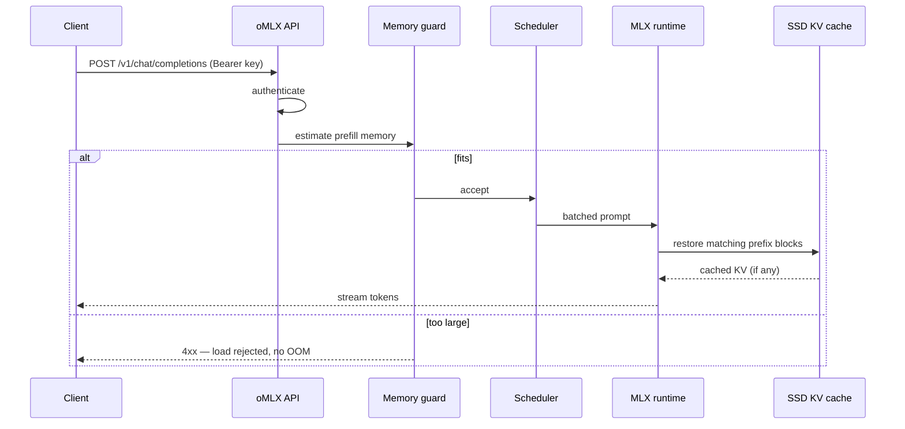
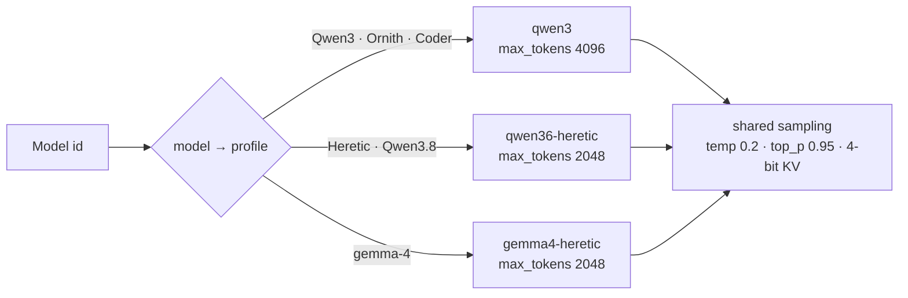
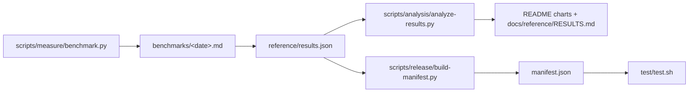

# Architecture — the request path

Written companion to
[`architecture.html`](architecture.html). The HTML is the interactive version;
this page is the one GitHub renders and a reviewer diffs.

## One request, end to end

## The sequence

## The profile decision

Which settings a request runs with is decided by the model → profile mapping, not
by the client:

## The benchmark pipeline

How a number gets into the README:

## Notes

- **Loopback only.** The API binds `127.0.0.1`; there is no remote listener. See
  [`../security/README.md`](../../security/README.md).
- **One model at a time.** `max_concurrent_requests` is 1; the scheduler's
  batching exists but is not exercised by this benchmark.
- **The guard is the safety valve.** A third large model is rejected by the
  prefill estimate rather than crashing the machine.
