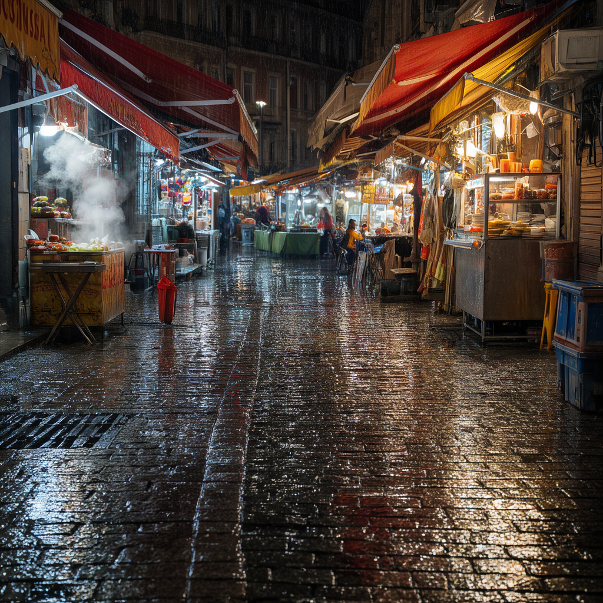
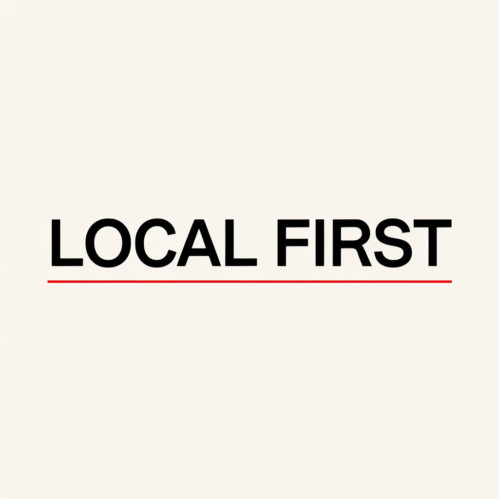
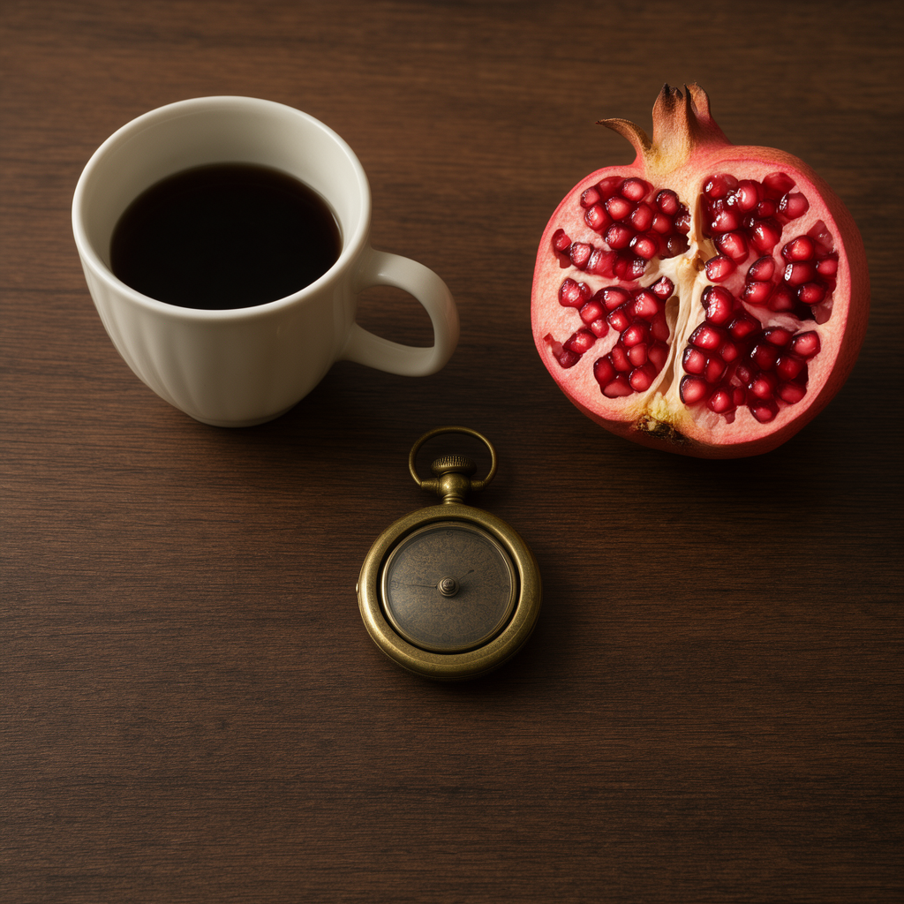
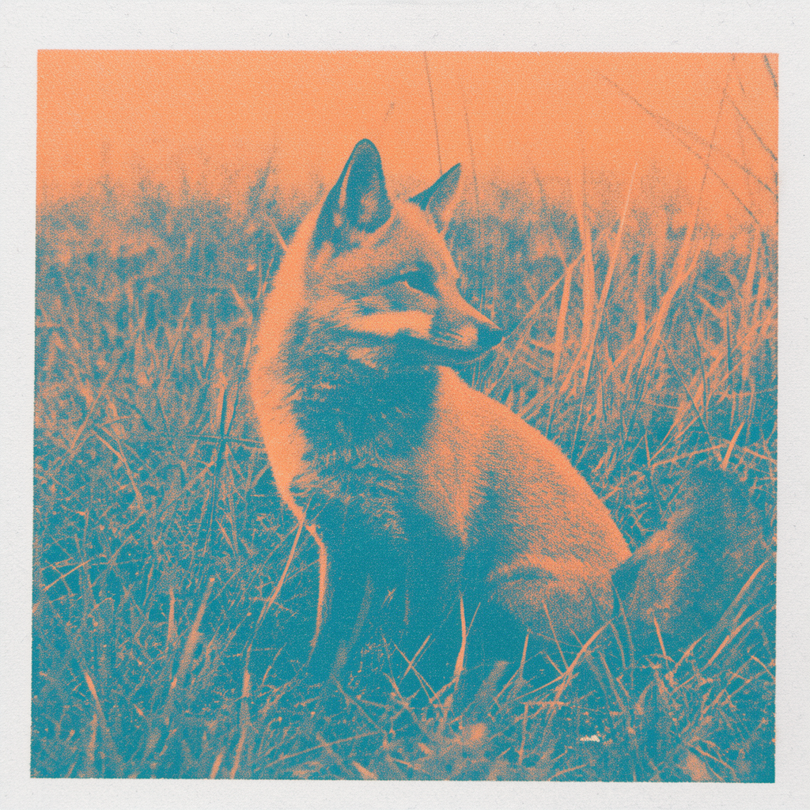
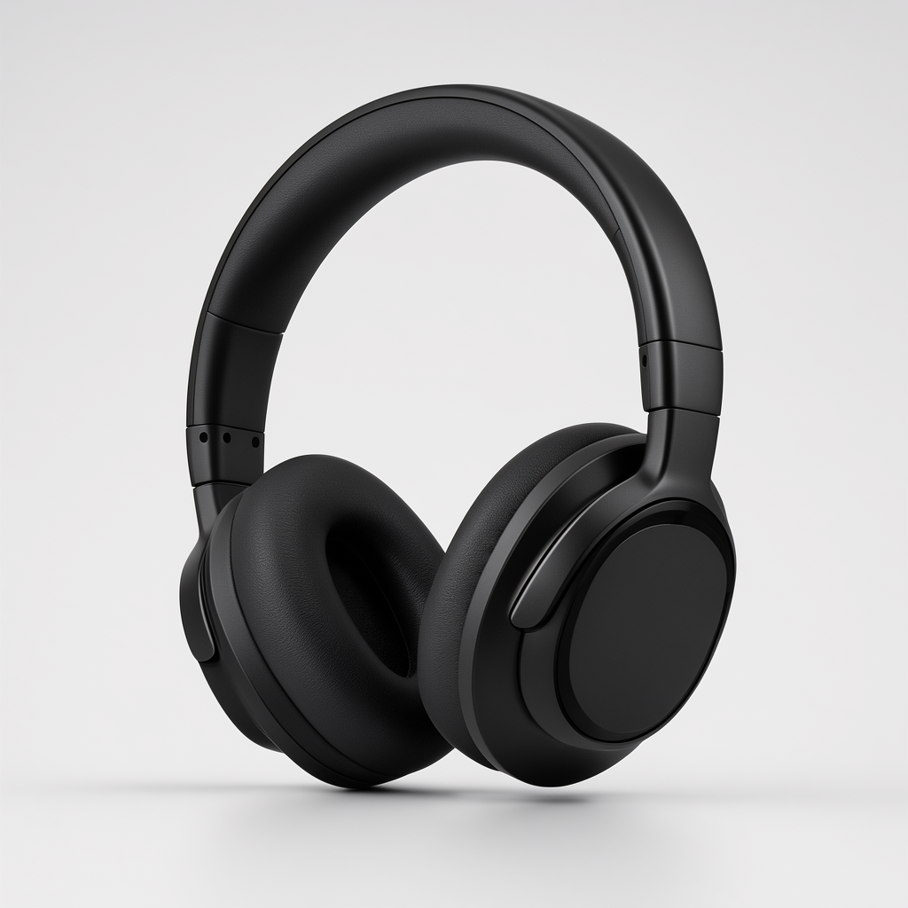
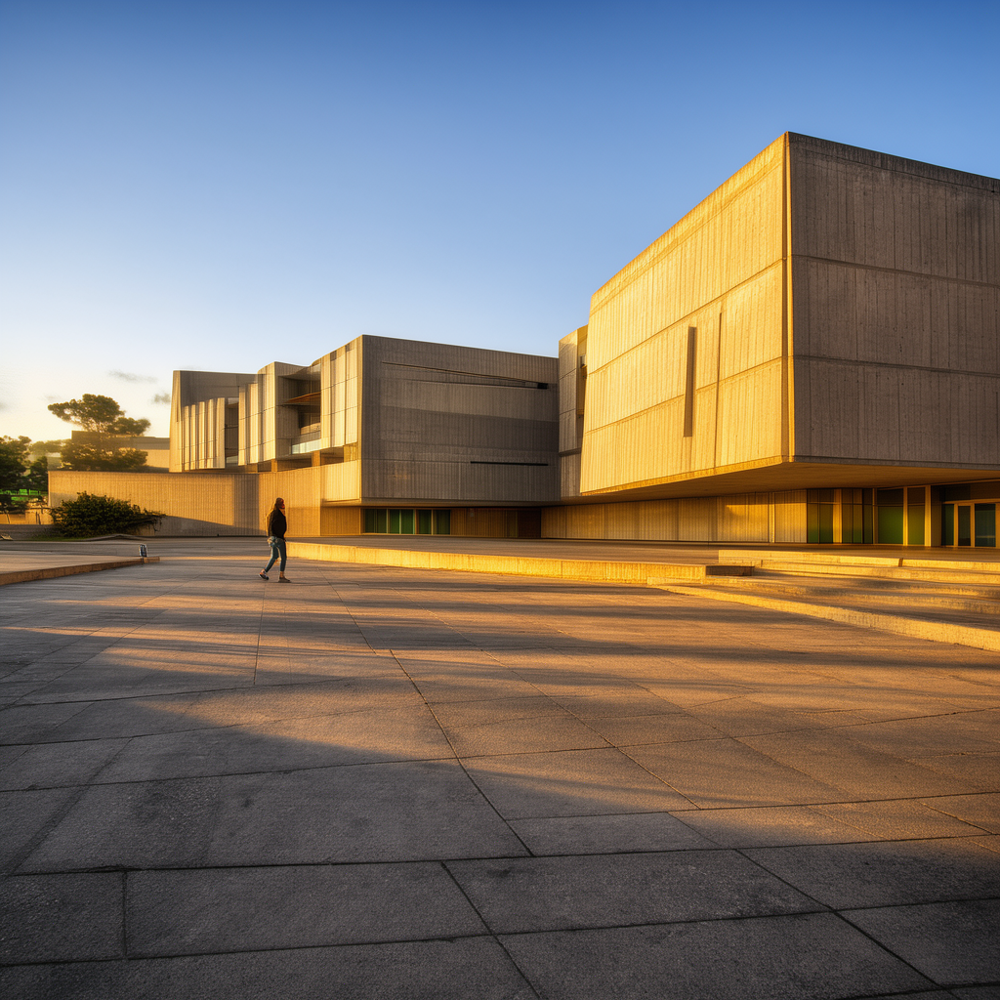

# Image generation — seconds per image

**Date:** 2026-11-12. One `mflux-generate-*` process per prompt, run through [mflux](https://github.com/filipstrand/mflux), which is separate from the oMLX text server. Time is end-to-end wall clock, **model load included** (the CLI is one-shot).

| Model (profile) | Licence | Image | s/img | s/step | Size | OK |
|---|---|---:|---:|---:|---|:---:|
| `mflux-community/flux-3-image-klein-base-mflux-q8` (flux3-klein-q8) | FLUX Kommunity License v1.0 | `photoreal-market` | 191.0 | 11.94 | 1024×1024, 2.2 MB | ✅ |
| `mflux-community/flux-3-image-klein-base-mflux-q8` (flux3-klein-q8) | FLUX Kommunity License v1.0 | `portrait-hands` | 180.36 | 11.27 | 1024×1024, 1.6 MB | ✅ |
| `mflux-community/flux-3-image-klein-base-mflux-q8` (flux3-klein-q8) | FLUX Kommunity License v1.0 | `text-poster` | 180.42 | 11.28 | 1024×1024, 0.5 MB | ✅ |
| `mflux-community/flux-3-image-klein-base-mflux-q8` (flux3-klein-q8) | FLUX Kommunity License v1.0 | `composition-stilllife` | 180.41 | 11.28 | 1024×1024, 1.5 MB | ✅ |
| `mflux-community/flux-3-image-klein-base-mflux-q8` (flux3-klein-q8) | FLUX Kommunity License v1.0 | `stylised-risograph` | 180.57 | 11.29 | 1024×1024, 2.2 MB | ✅ |
| `mflux-community/flux-3-image-klein-base-mflux-q8` (flux3-klein-q8) | FLUX Kommunity License v1.0 | `product-headphones` | 180.12 | 11.26 | 1024×1024, 1.0 MB | ✅ |
| `mflux-community/flux-3-image-klein-base-mflux-q8` (flux3-klein-q8) | FLUX Kommunity License v1.0 | `photoreal-architecture` | 180.47 | 11.28 | 1024×1024, 1.6 MB | ✅ |
| `mflux-community/flux-3-image-klein-base-mflux-q8` (flux3-klein-q8) | FLUX Kommunity License v1.0 | `text-signage` | 181.52 | 11.35 | 1024×1024, 1.7 MB | ✅ |

_s/img is what a person waits for one finished image on this machine. Because each CLI call reloads the model, it is a cold number; the steady-state per-step cost is the `s/step` column._

## The images themselves

Same eight prompts as the `klein-q8` run, the same one-shot CLI, but 16 steps
instead of 4 and a larger model — so each image costs ~180 s against ~22 s. The
comparison that matters is therefore not "is it prettier" but "what do the extra
3 minutes buy". The two runs are side by side in
[`image-benchmark-2026-11-12.md`](image-benchmark-2026-11-12.md), which shows the
same prompts from `flux2-klein-4b`.

### `photoreal-market` — photoreal

> Photorealistic rainy-night street market in Istanbul, wet cobblestones reflecting red and yellow awnings, steam rising from a food stall, shallow depth of field, shot on 35mm, natural colour grading.

### `portrait-hands` — portrait

> Close-up portrait of an older fisherman mending a net, weathered hands clearly visible with all fingers, warm low sun from the left, detailed skin and rope texture, neutral background.

### `text-poster` — text rendering

> Minimalist swiss-style poster with the exact headline "LOCAL FIRST" in bold black Helvetica on an off-white background, a single thin red horizontal rule below the text, generous margins, flat vector look.

### `composition-stilllife` — composition

> Overhead still life on a dark oak table: exactly three objects — a white ceramic mug, a brass pocket watch, and a ripe pomegranate cut in half. Warm side light, soft shadows, each object distinct and fully in frame.

### `stylised-risograph` — stylised

> Two-colour risograph print of a fox sitting in tall grass at dusk, visible paper grain and slight misregistration, limited palette of teal and warm orange, bold shapes, no outlines.

### `product-headphones` — product shot

> Studio product shot of matte-black over-ear headphones on a seamless light-grey backdrop, three-point softbox lighting, subtle reflection on the surface below, crisp edges, commercial catalogue style.

### `photoreal-architecture` — photoreal

> Wide architectural photograph of a concrete brutalist library at golden hour, long shadows across a plaza, a single figure walking, tilt-shift correction so verticals are straight, high dynamic range.

### `text-signage` — text rendering

> Photograph of a small neighbourhood coffee shop window at night with the hand-painted sign reading "OPEN" in warm neon-green light, condensation on the glass, brass fittings, cinematic bokeh of the street behind.

